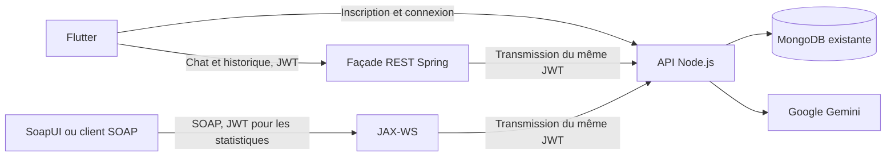

# Hkili

Hkili est un assistant conversationnel mobile inspiré de la culture
tunisienne. Le dépôt réunit une application Flutter, une API Node.js/Express,
une persistance MongoDB et une intégration Google Gemini côté serveur. Une
extension SOA ajoute une façade REST Spring Boot et un service SOAP JAX-WS,
sans déplacer l'authentification, les données ni la logique d'IA hors de Node.

## Objectifs

- Proposer une application mobile de conversation avec historique.
- Centraliser les comptes, les conversations, les messages et les secrets dans
  le backend Node.js.
- Illustrer l'intégration de services REST et SOAP au-dessus d'un domaine
  métier unique.

## Fonctionnalités

- Parcours Flutter d'accueil, inscription, connexion, invité, chat, historique
  et profil.
- API Express versionnée avec authentification JWT et données MongoDB.
- Génération Gemini avec modèles primaire et secondaire, reprises bornées et
  erreurs filtrées.
- Façade Spring Boot sécurisée par Bearer JWT et documentée avec OpenAPI.
- Opérations SOAP de comptage de mots et de statistiques calculées sur les
  messages réels d'une conversation.
- Tests automatisés pour Node, Flutter, Spring REST et JAX-WS.

Le mode invité conserve une conversation locale de démonstration ; il ne crée
pas de données serveur. La génération réelle dépend de la configuration et de
la disponibilité du service Gemini.

## Technologies

| Domaine | Technologies |
| --- | --- |
| Application mobile | Flutter, Dart |
| API et logique métier | Node.js, Express, Mongoose |
| Façade REST SOA | Java 17, Spring Boot, Spring Security, springdoc OpenAPI |
| Service SOAP SOA | Java 17, Jakarta JAX-WS, Eclipse Metro |
| Base de données | MongoDB |
| Génération de texte | API REST Google Gemini |
| Tests | `node:test`, Flutter Test, JUnit 5, Spring Test |

## Architecture



Node.js reste l'autorité pour les comptes, la propriété des conversations,
MongoDB et Gemini. Spring et SOAP délèguent les opérations au même backend ;
aucune seconde base ni copie de conversation n'est créée. Flutter utilise
Node pour l'inscription et la connexion, et Spring pour le chat authentifié et
l'historique.

## Structure du dépôt

```text
backend/                 API Node.js, services, modèles MongoDB et Gemini
mobile/                  Application Flutter
soa/
  common-client/         Client HTTP partagé vers Node
  spring-rest/           Façade REST Spring Boot et documentation OpenAPI
  jaxws-soap/            Service SOAP JAX-WS exécuté par Metro
docs/                    Documentation technique
docs/soa/                Contrats et vérifications SOA
docs/rapport/            Rapport académique en français
```

## Prérequis

- Git
- Node.js 22.9 ou version ultérieure et npm
- Flutter SDK et Dart
- MongoDB, local ou hébergé
- JDK 17 pour l'exécution prise en charge des modules SOA
- Accès Internet lors du premier usage du Maven Wrapper
- Clé Google Gemini pour générer des réponses réelles

Le code Java cible la version 17. Dans l'environnement de vérification, Maven
a été exécuté avec le JDK 25 d'IntelliJ et les processus Spring/SOAP avec le
JRE 21 d'Eclipse. Aucun JDK 17 n'était installé : son exécution n'a donc pas
été validée.

## Installation et configuration

### Backend Node.js

Depuis la racine, dans PowerShell :

```powershell
Set-Location .\backend
npm ci
if (-not (Test-Path .env)) { Copy-Item .env.example .env }
```

Renseignez localement `MONGODB_URI`, un `JWT_SECRET` robuste d'au moins
32 octets UTF-8 et, pour la génération, les paramètres Gemini. Ne partagez
pas et n'ajoutez pas `.env` à Git.

### Configuration d'environnement

| Variable | Service | Rôle |
| --- | --- | --- |
| `MONGODB_URI` | Node | URI de la base MongoDB |
| `JWT_SECRET` | Node et Spring | Secret commun de vérification HS256 |
| `GEMINI_API_KEY` | Node | Clé d'accès Gemini, jamais envoyée au mobile ou à Java |
| `GEMINI_MODEL` | Node | Modèle Gemini principal |
| `GEMINI_FALLBACK_MODEL` | Node | Modèle de repli |
| `NODE_API_BASE_URL` | Spring et SOAP | URL de l'API Node versionnée |
| `SPRING_PORT` | Spring | Port REST, `8081` par défaut |
| `SOAP_HOST`, `SOAP_PORT` | SOAP | Adresse et port, `127.0.0.1:8082` par défaut |
| `API_BASE_URL` | Flutter | URL facultative du backend Node |
| `SOA_API_BASE_URL` | Flutter | URL facultative de Spring |

Le backend charge `backend/.env`. Les modules Java lisent les variables
d'environnement du processus ; `soa/.env.example` décrit les paramètres sans
être chargé automatiquement. Utilisez les fichiers d'exemple comme référence
de configuration et ne remplacez pas une configuration locale existante.

### MongoDB et Gemini

Node.js est le seul service qui se connecte à MongoDB et à Gemini. Les modules
Java ne créent pas de base distincte. La commande `npm run diagnose:gemini`,
lancée depuis `backend/`, effectue une requête réelle au fournisseur et peut
consommer du quota ; les tests automatisés n'appellent pas Gemini.

## Démarrage

Démarrez MongoDB puis Node :

```powershell
Set-Location .\backend
npm start
```

Pour Spring, installez d'abord les modules partagés du réacteur Maven. Dans un
autre terminal PowerShell, configurez `JWT_SECRET` avec la même valeur que
Node, sans l'enregistrer dans le dépôt, puis exécutez :

```powershell
Set-Location .\soa
.\mvnw.cmd -pl spring-rest -am install -DskipTests
Set-Location .\spring-rest
$secret = Read-Host 'Saisir le JWT_SECRET configuré pour Node' -AsSecureString
$env:JWT_SECRET = [System.Net.NetworkCredential]::new('', $secret).Password
Remove-Variable secret
$env:NODE_API_BASE_URL = 'http://127.0.0.1:3000/api/v1'
..\mvnw.cmd spring-boot:run
```

Pour SOAP :

```powershell
Set-Location .\soa
.\mvnw.cmd install -DskipTests
Set-Location .\jaxws-soap
$env:NODE_API_BASE_URL = 'http://127.0.0.1:3000/api/v1'
..\mvnw.cmd exec:java
```

Spring écoute par défaut sur `http://localhost:8081`. Le JSON OpenAPI est
disponible sur `http://localhost:8081/v3/api-docs` et Swagger UI sur
`http://localhost:8081/swagger-ui.html`. Le WSDL SOAP est publié à
`http://localhost:8082/soap/hkili?wsdl` lorsque le service SOAP est lancé.

Lancer l'application Flutter :

```powershell
Set-Location .\mobile
flutter pub get
flutter run
```

Pour l'émulateur Android, les adresses alternatives peuvent être indiquées
explicitement avec
`--dart-define=API_BASE_URL=http://10.0.2.2:3000/api/v1` et
`--dart-define=SOA_API_BASE_URL=http://10.0.2.2:8081`. Ces variables sont des
adresses de services, pas des emplacements pour des secrets.

## API et services

Les contrats détaillés se trouvent dans [docs/api.md](docs/api.md) et
[docs/soa/README.md](docs/soa/README.md).

| Service | Opération | Authentification |
| --- | --- | --- |
| Spring REST | `POST /chat` | Bearer JWT |
| Spring REST | `GET /conversations` | Bearer JWT |
| Spring REST | `GET /conversations/{id}` | Bearer JWT |
| Spring REST | `PATCH /conversations/{id}` | Bearer JWT |
| Spring REST | `DELETE /conversations/{id}` | Bearer JWT |
| SOAP | `compterMots(texte)` | Aucune |
| SOAP | `statistiques(idConversation)` | Bearer JWT |

## Tests et génération Android

```powershell
Set-Location .\backend
npm test

Set-Location ..\mobile
flutter analyze
flutter test
flutter build apk --debug

Set-Location ..\soa
.\mvnw.cmd test
.\mvnw.cmd package
```

Lors de la dernière vérification, les 44 tests Node, les 14 tests Flutter,
l'analyse statique et la génération de l'APK debug ont réussi. Maven a exécuté
14 tests (10 Spring et 4 SOAP) et le packaging a réussi. Le JDK 17 n'étant pas
disponible, ces résultats ne valident pas l'exécution sur cette version.

L'APK debug est générée dans
`mobile\build\app\outputs\flutter-apk\app-debug.apk`.

## Sécurité et limites

- Ne versionnez jamais `.env`, les secrets JWT/Gemini, les jetons ou les clés
  de signature.
- Flutter et Java ne reçoivent ni la clé Gemini ni l'URI MongoDB.
- Node revalide chaque jeton et chaque propriété de conversation relayés par
  Spring ou SOAP.
- Une requête réelle Spring → Node → MongoDB → Gemini a retourné une réponse
  et l'historique a ensuite contenu trois messages. D'autres sondes Gemini ont
  rencontré un délai d'attente et une limite de quota ; la disponibilité varie.
- L'application a été installée et lancée sur un émulateur, mais son parcours
  utilisateur n'a pas été vérifié manuellement.
- Le WSDL est produit à l'exécution par Metro.
- Le mode invité reste local et n'enregistre pas de conversations côté serveur.
- La configuration Android conserve l'identifiant de développement
  `com.example.hkili_mobile` et la signature debug pour le type release ; aucune
  version destinée à la distribution n'a été validée.

Les résultats détaillés et les limites de validation sont décrits dans
[docs/soa/testing.md](docs/soa/testing.md).
