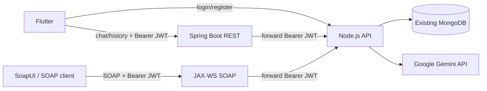

# Hkili

Hkili is a Tunisian-inspired conversational assistant. The monorepo combines a
Flutter mobile client, a Node.js/Express backend, MongoDB persistence, and
Google Gemini text generation. An academic SOA extension adds a Spring Boot
REST façade and a JAX-WS SOAP service while keeping Node.js authoritative for
authentication, conversation data, and AI generation.

## Project objectives

- Provide a mobile conversational experience with authenticated chat and
  conversation history.
- Keep credentials, Gemini calls, and MongoDB access on the backend.
- Demonstrate cross-platform development and service-oriented integration
  using REST and SOAP.

## Features

- Flutter welcome, authentication, guest, chat, history, and profile flows.
- Express REST API with JWT authentication and MongoDB-backed users,
  conversations, and messages.
- Gemini generation with configurable primary/fallback models, bounded
  transient retries, and sanitized provider errors.
- Spring Boot REST façade with JWT Bearer validation and OpenAPI/Swagger UI.
- JAX-WS SOAP word counting and statistics calculated from an owned conversation.
- Automated backend, Flutter, Spring REST, and SOAP tests.

Guest chat is a local demonstration flow; authenticated conversations use the
backend. A live Gemini result depends on the configured key, model availability,
quota, and Google's service availability.

## Screenshots

Screenshots are not currently included. Add reviewed, real application captures
here before submitting or publishing this repository.

<!-- Screenshot placeholder: welcome and authentication screens -->
<!-- Screenshot placeholder: authenticated chat and conversation history -->

## Technology stack

| Area | Technology |
| --- | --- |
| Mobile | Flutter and Dart |
| Core API and domain services | Node.js, Express, Mongoose |
| SOA REST façade | Java 17, Spring Boot, Spring Security, springdoc OpenAPI |
| SOA SOAP service | Java 17, Jakarta JAX-WS, Eclipse Metro |
| Database | MongoDB |
| AI | Google Gemini `generateContent` REST API |
| Tests | Node test suite, Flutter test/analyze, JUnit 5 and Spring Test |

## Architecture

Flutter uses Node.js for registration and login, and the SOA Spring REST
façade for authenticated chat and conversation operations. Spring verifies
the existing HS256 JWT and forwards it to Node. Node revalidates ownership,
executes domain operations, persists records in the existing MongoDB, and
calls Gemini when requested. The SOAP service uses the same Node API and token
for conversation statistics; it does not connect to MongoDB directly.



See [docs/architecture.md](docs/architecture.md) and [docs/soa/](docs/soa/README.md).

## Repository structure

```text
backend/                 Node.js API, domain services, MongoDB and Gemini
mobile/                  Flutter application
soa/
  common-client/         Shared Java HTTP client for the Node API
  spring-rest/            Spring Boot REST façade and OpenAPI
  jaxws-soap/             JAX-WS SOAP service and Metro runtime
  .mvn/                   Maven Wrapper configuration
docs/                    Existing architecture and Node REST API docs
docs/soa/                SOA contracts, setup and test guidance
docs/rapport/            Academic report source in French
```

## Prerequisites

- Git
- Node.js 22.9+ and npm
- Flutter SDK and Dart (see the Flutter SDK's current platform requirements)
- MongoDB, local or hosted
- Java 17 JDK for running the SOA applications
- Internet access on first Maven Wrapper use to download Maven and dependencies
- A Google Gemini API key for live AI responses

The source targets Java 17. The current development environment used JDK 21 to
compile with `--release 17`; JDK 17 itself was not installed or used for the
runtime verification in this workspace.

## Installation

### Node.js backend

From the repository root in PowerShell:

```powershell
Set-Location .\backend
npm ci
if (-not (Test-Path .env)) { Copy-Item .env.example .env }
```

Edit `backend/.env` locally. Set a MongoDB URI, a strong `JWT_SECRET` of at
least 32 UTF-8 bytes, and a Gemini key/model if AI generation is required. Do
not commit or share the `.env` file.

### SOA modules

The Maven Wrapper is under `soa/` and builds the three Maven reactor modules:

```powershell
Set-Location .\soa
.\mvnw.cmd test
```

Set `JWT_SECRET` in each terminal used to launch Spring so it exactly matches
the secret used by the Node backend. Set `NODE_API_BASE_URL` when Node is not
using its default local address. Values can be entered into the current
PowerShell session without adding them to a committed file:

```powershell
$env:JWT_SECRET = '<same local value as backend/.env>'
$env:NODE_API_BASE_URL = 'http://127.0.0.1:3000/api/v1'
```

### Flutter

```powershell
Set-Location .\mobile
flutter pub get
```

The Android emulator defaults to the host endpoints `10.0.2.2:3000` (Node)
and `10.0.2.2:8081` (Spring). Configure alternate endpoints at build/run time
with `--dart-define=API_BASE_URL=...` and `--dart-define=SOA_API_BASE_URL=...`.
Do not put secrets in Dart defines.

## Environment configuration

The Node API loads `backend/.env` through its existing environment loader.
`backend/.env.example` contains safe placeholders. Java services read process
environment variables; `soa/.env.example` documents supported local settings
but is not automatically loaded as a dotenv file.

| Variable | Used by | Purpose |
| --- | --- | --- |
| `MONGODB_URI` | Node | Existing MongoDB connection |
| `JWT_SECRET` | Node and Spring | Shared HS256 token verification secret |
| `GEMINI_API_KEY` | Node | Gemini API credential; never added to Flutter or SOA |
| `GEMINI_MODEL` | Node | Configured Gemini primary model |
| `GEMINI_FALLBACK_MODEL` | Node | Configured Gemini fallback model |
| `NODE_API_BASE_URL` | Spring and SOAP | Node API base URL |
| `SPRING_PORT` | Spring | REST port; default `8081` |
| `SOAP_HOST`, `SOAP_PORT` | SOAP | Bind address and port; defaults `127.0.0.1:8082` |
| `API_BASE_URL` | Flutter | Optional Node auth base URL, including `/api/v1` |
| `SOA_API_BASE_URL` | Flutter | Optional Spring base URL |

## MongoDB configuration

MongoDB remains owned by the Node backend. Configure `MONGODB_URI` in
`backend/.env`; neither Java module has a MongoDB driver or creates a second
database. Existing user, conversation, and message records are unchanged.

## Gemini configuration

Gemini credentials and model settings belong only in the backend environment.
The Node service uses the configured primary/fallback models and its bounded
retry strategy. Check real model access with `npm run diagnose:gemini` from
`backend/`. A successful mocked test does not establish that Google's API is
available to a particular key or project.

## Starting the services

Start MongoDB first, then the Node backend:

```powershell
Set-Location .\backend
npm start
```

In another PowerShell terminal, configure the shared JWT secret and start the
Spring façade:

```powershell
Set-Location .\soa\spring-rest
$env:JWT_SECRET = '<same local value as backend/.env>'
$env:NODE_API_BASE_URL = 'http://127.0.0.1:3000/api/v1'
..\mvnw.cmd spring-boot:run
```

Start the SOAP endpoint after building/installing the shared Maven client:

```powershell
Set-Location .\soa
.\mvnw.cmd install -DskipTests
Set-Location .\jaxws-soap
..\mvnw.cmd exec:java
```

Spring REST is available at `http://localhost:8081`; Swagger UI is at
`http://localhost:8081/swagger-ui.html`. SOAP publishes its WSDL at
`http://localhost:8082/soap/hkili?wsdl`.

Run the mobile app on an Android emulator:

```powershell
Set-Location .\mobile
flutter run
```

## Running tests and analysis

```powershell
Set-Location .\backend
npm test
npm run diagnose:gemini

Set-Location ..\mobile
flutter analyze
flutter test

Set-Location ..\soa
.\mvnw.cmd test
```

`npm run diagnose:gemini` makes a real provider request and requires a valid
locally configured key. Standard automated tests mock external Gemini calls.

## Building the Android APK

```powershell
Set-Location .\mobile
flutter build apk --debug
```

The debug APK is written under `mobile\build\app\outputs\flutter-apk\`.

## API documentation

- [Node.js API](docs/api.md)
- [SOA REST API and SOAP contract](docs/soa/README.md)
- Swagger UI when Spring is running: `http://localhost:8081/swagger-ui.html`
- SOAP WSDL when the SOAP service is running:
  `http://localhost:8082/soap/hkili?wsdl`

## Security considerations

- Never commit `.env`, JWT secrets, Gemini keys, tokens, or signing files.
- The mobile application never receives the Gemini key or MongoDB URI.
- Java REST validates the shared bearer JWT; Node remains authoritative and
  rechecks the token and conversation ownership for proxied requests.
- SOAP statistics require and forward a bearer token; word counting uses only
  the supplied text.
- Use TLS and secret-management facilities outside local development.

## Known limitations

- The Java modules target Java 17, but this workspace's available compiler was
  JDK 21; run and verify on JDK 17 before claiming that runtime compatibility.
- At the last live diagnostic, Google's Models API listed 49 models supporting
  `generateContent`, including the two configured names. Generation timed out
  on `gemini-3.6-flash`; a separate `gemini-3.8-flash` probe returned HTTP 429
  quota exhaustion. No real response was generated, so live AI operation is
  not verified.
- Automated tests use mocked Node/Gemini boundaries. A live Gemini request and
  a complete Android-to-MongoDB run require local credentials, services, and an
  emulator and are not implied by those tests.
- Guest chat remains local and does not create persisted conversations.
- SOAP WSDL is generated by Metro at runtime rather than checked in as a
  generated static artifact.

## Future improvements

- Run a full JDK 17, Android emulator, MongoDB, and Gemini-backed end-to-end
  validation in a configured environment.
- Add CI jobs for Node, Flutter, and Maven.
- Add reviewed screenshots and a verified deployment configuration.
- Consider request correlation IDs and service-level metrics without logging
  credentials or message contents.

## Authors and academic context

Author, institution, supervisor, and academic-year details have not been
verified in this repository. Add them only after confirmation. A French report
source with confirmation placeholders is available in
[docs/rapport/rapport-soa.md](docs/rapport/rapport-soa.md).
