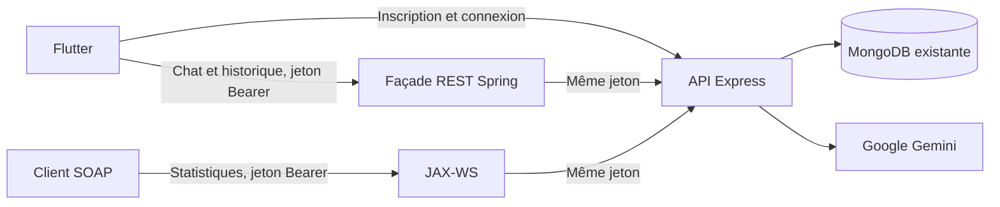

# Architecture de Hkili

## Vue d'ensemble

Hkili est un monorepo composé d'un client mobile Flutter, d'une API
Node.js/Express et de modules Java pour les interfaces SOA. MongoDB est
l'unique couche de persistance. Le backend Node reste propriétaire de
l'authentification, des règles métier, des données et des appels Gemini.

## Composants

### Application mobile (`mobile/`)

L'application Flutter fournit les écrans Android et iOS, gère l'état de
l'interface et communique avec les API HTTP JSON. Elle ne se connecte pas
directement à la base de données ni au fournisseur d'IA.

### Backend Node.js (`backend/`)

Express expose l'API versionnée sous `/api/v1`. Le backend valide la
configuration et les entrées, authentifie les utilisateurs, applique les
contrôles de propriété et persiste les données avec Mongoose.

Le service Gemini utilise l'API `generateContent` par `fetch`, un contexte
limité aux dix derniers messages, des reprises bornées pour les erreurs
transitoires et un modèle de repli configurable. Les erreurs fournisseur sont
filtrées avant leur transmission au client.

### Modules SOA (`soa/`)

- `common-client/` centralise les appels HTTP à l'API Node et le traitement
  des erreurs d'amont.
- `spring-rest/` expose la façade REST, vérifie les jetons HS256 et publie la
  documentation OpenAPI.
- `jaxws-soap/` expose les opérations `compterMots` et `statistiques` avec
  Metro. Les statistiques sont lues depuis Node.

## Flux d'une requête

Pour une opération de chat authentifiée, Flutter transmet la demande à Spring.
Spring contrôle la signature, l'expiration et le sujet du jeton, puis le
transmet à Node. Node vérifie à nouveau le jeton et la propriété de la
conversation, charge le contexte, appelle Gemini et enregistre les messages
après une génération réussie. Spring renvoie la réponse JSON à Flutter.

Les services Java ne possèdent ni accès MongoDB ni client Gemini. Cette
frontière évite de dupliquer les conversations, les utilisateurs et les règles
métier. L'opération `compterMots` traite uniquement le texte envoyé et ne
requiert pas de jeton ; `statistiques` lit les messages existants et est
protégée par le jeton Hkili.

## Configuration et journaux

Node lit ses paramètres dans l'environnement et dans `backend/.env`. Les
variables d'environnement non vides ont priorité. Les services Java lisent
les variables de leur processus ; `JWT_SECRET` doit correspondre à celui de
Node.

Les journaux de requêtes contiennent la méthode, le chemin, le statut et la
durée, sans le corps, les en-têtes ou les paramètres de requête. Le chemin
peut contenir un identifiant de conversation. Le client Flutter journalise
également l'URI et le statut des appels en mode debug.

Pour le navigateur, l'adresse par défaut de développement est
`192.168.100.116`; elle est spécifique au réseau local. Utilisez les
variables Dart `API_BASE_URL` et `SOA_API_BASE_URL` pour choisir les adresses
réellement joignables depuis le navigateur.

## État vérifié

Les tests automatisés couvrent Node, Flutter, Spring REST et SOAP. Des essais
réels ont aussi vérifié la chaîne Spring → Node → MongoDB, le contrôle de
propriété et les statistiques SOAP sur une conversation temporaire. Une
requête réelle a obtenu et persisté une réponse Gemini. Le parcours de
l'interface Flutter n'a pas été vérifié manuellement sur l'émulateur ; son
intégration de bout en bout n'est donc pas affirmée.

Les détails des contrats, des tests et des limites sont présentés dans
[docs/api.md](api.md), [docs/soa/README.md](soa/README.md) et
[docs/soa/testing.md](soa/testing.md).
