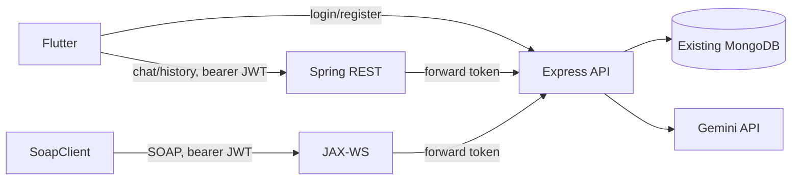

# Hkili Architecture

## Overview

Hkili is organized as a monorepo with a Flutter mobile client, a Node.js and
Express API, and shared project documentation. MongoDB is the persistence layer.
Authentication, conversation CRUD, and message persistence are implemented.
Gemini conversational AI integration is available when a valid server-side API
key is configured.

## Components

### `mobile/`

The Flutter application provides the Android and iOS user interface and
communicates with the backend through a JSON HTTP API. It contains presentation
and client-side application code, not direct database access.

### `backend/`

The Node.js service uses Express to expose the versioned JSON API (`/api/v1`),
validate configuration, and handle errors, request logging, authentication, and
persistence.
- **Database**: Mongoose connects to MongoDB with resilient connection handling and indexing.
- **Authentication**: Passwords hashed with `bcrypt`, sessions secured with signed JWTs (`HS256`).
- **Conversations & Messages**: Full CRUD lifecycle, strict ownership enforcement, chronological ordering, and pagination.
- **Gemini AI Service**: Google Gemini `generateContent` REST integration using Node.js `fetch`, context history windowing (last 10 messages), bounded transient retries, configurable primary/fallback models, provider diagnostics, and sanitized client errors.
- **Server Lifecycle**: Graceful shutdown handles open connections and closes MongoDB cleanly.

Credentials remain in backend environment configuration and must never be shipped in the mobile app.

### `docs/`

Project documentation describes system boundaries, development guidance, and the API contract:
- [API Documentation](api.md)

## Request and data flow

1. The mobile client sends authenticated HTTP requests (`Authorization: Bearer <token>`) with JSON to the backend.
2. The Express API validates input schemas and verifies authentication and resource ownership.
3. For chat operations:
   - The backend retrieves recent conversation history from MongoDB (capped at 10 messages for context).
   - The backend formats conversation contents and sends them to Google Gemini with Hkili's Tunisian system instructions.
   - Upon successful AI response, both the user message and assistant reply are persisted to MongoDB atomically, and the conversation's `lastMessageAt` timestamp is updated.
   - If Gemini fails (rate limit, timeout, provider error), no message is saved, preventing duplicate user messages.
4. The backend returns sanitized JSON envelopes to the client.

The mobile app never connects directly to MongoDB or external AI APIs. Backend
settings are read from environment variables, with local `.env` loading.
Non-empty deployment environment variables take precedence; blank environment
variables fall back to `.env`.
The backend repository ignores `.env` files; only non-secret defaults are included in `.env.example`.

Request logs record method, path, status, and duration, but not request bodies,
headers, or query strings.

## Monorepo boundaries

The mobile and backend projects have independent toolchains and dependency
manifests. They can be developed and validated independently, while this
repository root provides shared project context and documentation.

## SOA extension

The `soa/` Maven reactor adds two Java services without replacing Node.js:

- `spring-rest/` exposes authenticated REST endpoints for chat and conversation
  access, validates the existing HS256 bearer token, then forwards it to Node.
- `jaxws-soap/` publishes `compterMots` and `statistiques`; the latter calls the
  authenticated Node conversation API and computes statistics from its real
  message pages.
- `common-client/` centralizes the HTTP calls and response/error handling used
  by both Java services.

Node remains the single authority for account authentication, ownership,
MongoDB records, conversation business logic, and Gemini. Java does not connect
to MongoDB or Gemini and does not issue a second token or create duplicate
records. Flutter keeps registration/login on Node and uses Spring for
authenticated chat/history operations; guest mode remains local.

Spring requires `JWT_SECRET` to match the Node backend's local configuration.
It validates token signatures and the Mongo ObjectId subject, and Node
revalidates every forwarded request and conversation ownership. SOAP
`statistiques` similarly forwards the incoming bearer header. `compterMots`
accepts supplied text and does not access application data.

The REST façade adds `/chat`, `GET /conversations`,
`DELETE /conversations/{id}`, and history-preserving `GET`/`PATCH`
conversation routes. See [SOA integration documentation](soa/README.md).

## Current status

- Flutter Android/iOS application with Hkili custom-painted mascot, welcome flow, local navigation, and UI prototype.
- Express backend with environment validation, structured request logs, centralized error responses, and versioned health endpoint.
- MongoDB connection lifecycle with graceful startup/shutdown and schema models (`User`, `Conversation`, `Message`).
- User authentication complete: Registration, Login, and `/me` profile verification.
- Conversation and message persistence complete: CRUD operations, chronological ordering, pagination, cascaded deletion, and cross-user isolation.
- Google Gemini AI integration is complete behind `GEMINI_API_KEY`, with
  10-message conversation context, bounded 500/503 retries, a configurable
  fallback model, timeout/rate-limit handling, and persistence only after
  provider success.
- Flutter authentication and persisted chat/history/profile screens are
  integrated with the Express API. Guest mode remains an intentional local
  mock flow and is clearly labeled.
- The SOA Maven reactor contains the Spring REST façade and Metro SOAP service.
  Their automated tests mock the Node boundary; live full-stack verification
  remains environment-dependent.
