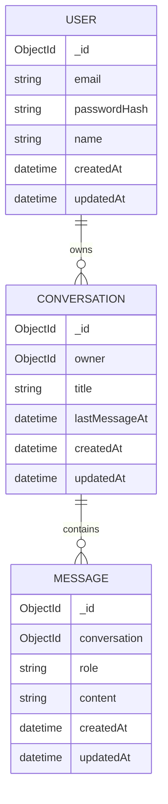

# Database

MongoDB is accessed only by the Node.js backend through Mongoose. Spring REST,
the SOAP service, and Flutter do not open database connections or create
parallel records.

## Existing entities

### User

Email is lowercased and trimmed, unique, and limited to 254 characters.
`passwordHash` is excluded from normal query selection and JSON output. The
optional name is limited to 80 characters.

### Conversation

Each conversation has an `owner` ObjectId reference to a user, a required title
up to 120 characters, `lastMessageAt`, and Mongoose timestamps. The compound
index supports listing by owner and recency.

### Message

Messages reference a conversation, use role `user` or `assistant`, and store
trimmed content up to 10,000 characters with timestamps. The compound index
supports chronological paging.

The API serializes ObjectIds as 24-character hexadecimal strings and presents
references as `ownerId` / `conversationId`. Java services pass data through and
do not map or persist these records independently.

## Persistence flow

Node verifies user and conversation ownership before database access. A
successful AI operation stores the user message and assistant reply in the
existing conversation; failed generation does not persist a fabricated
assistant response. Configure the database URI only in `backend/.env`.

No schema migration is required for the SOA extension.
