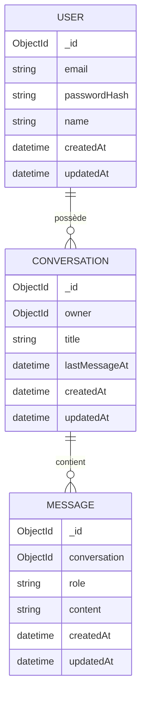

# Base de données

Seul le backend Node.js accède à MongoDB, au moyen de Mongoose. Flutter et
les modules Spring REST et SOAP ne se connectent pas à la base et ne créent
pas de copies des enregistrements.

## Entités existantes

### Utilisateur

L'adresse électronique est normalisée en minuscules, supprimée des espaces
superflus et unique ; sa longueur maximale est de 254 caractères. Le champ
`passwordHash` est exclu des sélections ordinaires et de la sérialisation JSON.
Le nom facultatif est limité à 80 caractères.

### Conversation

Une conversation possède une référence `owner` de type ObjectId, un titre
obligatoire de 120 caractères au plus, `lastMessageAt` et les horodatages
Mongoose. Un index composé prend en charge le classement par propriétaire et
date de mise à jour.

### Message

Chaque message référence une conversation, contient le rôle `user` ou
`assistant` et un texte nettoyé de 10 000 caractères au plus. Les horodatages
et l'index composé prennent en charge le tri chronologique et la pagination.

L'API sérialise les ObjectId sur 24 caractères hexadécimaux et expose les
références sous les noms `ownerId` et `conversationId`. Les services Java
transmettent les données sans les enregistrer dans un autre modèle.

## Persistance

Node vérifie l'identité et la propriété de la conversation avant l'accès aux
données. Une génération réussie enregistre les messages utilisateur et
assistant dans la conversation existante ; une génération échouée ne crée pas
de réponse assistant artificielle. L'URI MongoDB se configure uniquement dans
`backend/.env`.

Aucune migration de schéma n'est requise pour l'extension SOA.
