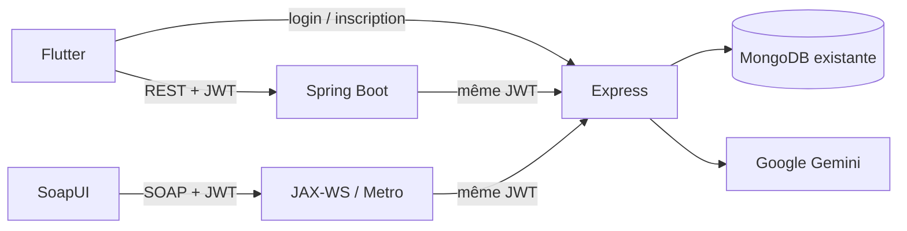
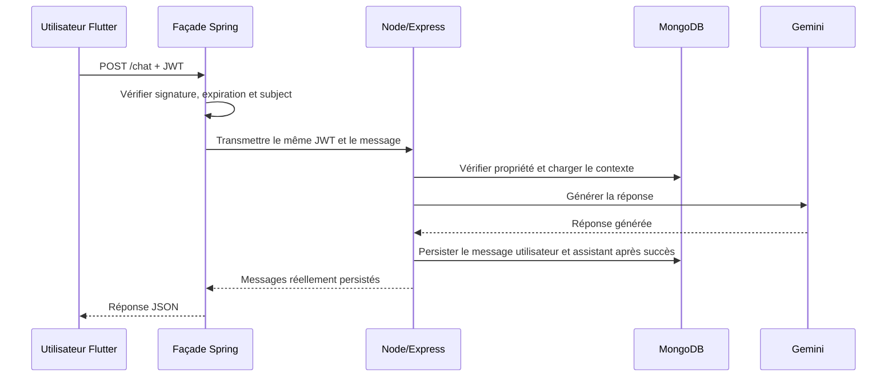
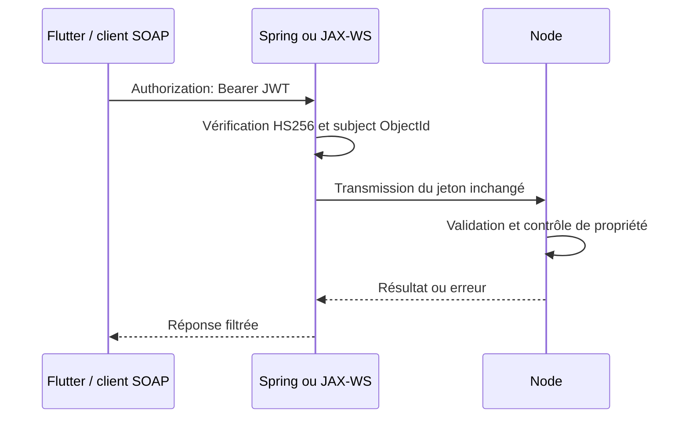
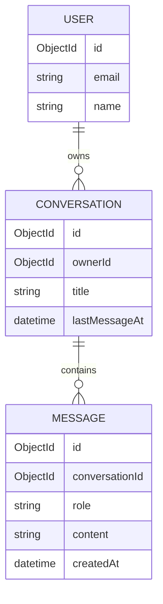

# Conception et intégration de services REST et SOAP pour l'application mobile Hkili

## Page de garde

**Conception et intégration de services REST et SOAP pour l'application mobile
Hkili**

## Résumé

Hkili est une application mobile conversationnelle inspirée de la culture
tunisienne. Le projet associe un client Flutter, une API Node.js/Express, une
base MongoDB et une intégration de génération de texte Google Gemini. Une
extension orientée services (SOA) ajoute une façade REST réalisée avec Spring
Boot et un service SOAP Java JAX-WS. Cette extension réutilise l'API Node
existante afin de préserver une source unique pour l'authentification, les
conversations, les messages et les appels d'intelligence artificielle.

Le service REST expose le chat et l'accès à l'historique sous authentification
Bearer. Le service SOAP fournit le comptage de mots et des statistiques
calculées à partir des messages réels d'une conversation. Les tests automatisés
isolent les dépendances externes ; ils ne constituent pas une preuve de
disponibilité de Gemini ou d'un déploiement complet.

**Mots-clés :** Flutter, Node.js, Spring Boot, REST, SOAP, JAX-WS, JWT, MongoDB,
Gemini, SOA.

## Table des matières

1. Introduction générale
2. Présentation du projet
3. Étude de l'existant et problématique
4. Analyse des besoins
5. Spécifications fonctionnelles et non fonctionnelles
6. Méthodologie
7. Architecture globale
8. Conception UML et services
9. Données et persistance
10. Réalisation du backend
11. Réalisation de l'application Flutter
12. Intégration de Gemini
13. Sécurité
14. Tests et validation
15. Preuves techniques
16. Difficultés, limites et perspectives
17. Conclusion
18. Références et annexes

## 1. Introduction générale

Les assistants conversationnels mobiles dépendent de plusieurs composants :
interface, authentification, stockage, logique métier et fournisseur d'IA.
L'enjeu du projet est de les organiser sans disperser les responsabilités ni
multiplier les sources de données. Le volet SOA ajoute des interfaces de
services demandées dans le cadre académique tout en conservant le backend
Node.js existant.

## 2. Présentation du projet

Hkili comprend une application Flutter, un backend Express versionné, une
persistance MongoDB et une intégration Gemini côté serveur. Les services Java
ajoutés sont :

- une API REST Spring Boot documentée avec OpenAPI/Swagger ;
- un endpoint SOAP JAX-WS publié par Metro et testable depuis SoapUI.

Le backend Node reste l'autorité du domaine. Les modules Java sont des façades
et des adaptateurs, non des systèmes de persistance alternatifs.

## 3. Étude de l'existant et problématique

Avant l'extension, le projet possédait déjà l'authentification, les opérations
de conversations/messages, la validation de propriété et l'appel Gemini dans
Node. Flutter gérait l'interface, le stockage du jeton et l'historique.

Le besoin académique exige des services REST Spring et SOAP JAX-WS. Remplacer
Express ou réécrire la logique de conversation aurait créé des responsabilités
concurrentes. La problématique est donc de satisfaire ces contrats d'interface
tout en conservant un seul domaine métier et une seule base de données.

## 4. Analyse des besoins

### Acteurs

- **Utilisateur mobile :** s'authentifie, échange des messages et consulte ses
  conversations.
- **Client SOAP / SoapUI :** appelle le comptage de mots ou les statistiques.
- **Node.js :** valide les demandes, applique les règles, persiste les données,
  et appelle Gemini.
- **Gemini :** fournisseur externe de génération de texte, appelé uniquement
  depuis Node.

### Besoins fonctionnels

1. Envoyer un message par `POST /chat`.
2. Lister les conversations et en consulter l'historique.
3. Renommer et supprimer une conversation appartenant à l'utilisateur.
4. Compter les mots d'un texte via SOAP.
5. Calculer des statistiques à partir des messages réels d'une conversation.
6. Présenter des erreurs lisibles sans exposer les diagnostics du fournisseur.

## 5. Spécifications

### Fonctionnelles

Les routes Spring exigent le jeton Bearer déjà émis par Node. Les demandes de
chat sont relayées vers le service conversation existant. Les statistiques SOAP
requièrent également un jeton et sont calculées sur les pages de messages
retournées par Node. Le comptage de texte autonome ne requiert pas de compte.

### Non fonctionnelles

- Maintenabilité par séparation des adaptateurs et contrats.
- Confidentialité : aucun secret Gemini dans Flutter, Java ou Git.
- Cohérence : absence de seconde base ou de copies de conversations.
- Résilience : délais réseau bornés et erreurs d'amont explicites.
- Traçabilité académique : distinguer tests automatisés et essais réels.

## 6. Méthodologie de développement

L'extension est organisée en petits modules Maven : un client HTTP partagé, une
façade REST Spring et un service SOAP Metro. Les tests automatisés utilisent des
mocks pour le Node API. L'intégration Flutter a ensuite été dirigée vers Spring
pour le chat et l'historique, tandis que login/inscription restent sur Node.

## 7. Architecture globale

Le flux d'un message est le suivant :

## 8. Conception UML et services

### Composants

Le module `common-client` contient l'interface `NodeApi`, son adaptateur HTTP
et une exception d'amont. `spring-rest` valide les entrées, vérifie le JWT et
mappe les erreurs. `jaxws-soap` publie `compterMots` et `statistiques`.

### Authentification

Spring et Node utilisent le même secret de signature, mais Node demeure
l'autorité finale pour les ressources et leur propriété.

## 9. Données et persistance

Les données restent dans les collections du backend Node. Java n'ajoute pas de
collections. Le domaine comporte des utilisateurs, des conversations
rattachées à un propriétaire et des messages associés à une conversation. Les
identifiants de conversation exposés sont des ObjectId MongoDB sous forme de
24 caractères hexadécimaux.

Les noms précis des collections et contraintes sont définis par les modèles
Mongoose existants ; consulter le code du backend avant de modifier le schéma.

## 10. Développement du backend

Node/Express conserve les routes de comptes, les services conversation, les
modèles Mongoose, les contrôles d'accès, ainsi que l'intégration Gemini. Les
modules Java font des appels HTTP vers l'API Node versionnée. Ils ne reproduisent
pas les règles métier ou le stockage.

La façade REST expose `POST /chat`, `GET /conversations`,
`DELETE /conversations/{id}` et les routes supplémentaires de consultation et
de renommage nécessaires à l'historique Flutter.

## 11. Application Flutter

Flutter conserve les écrans et le mode invité existants. L'authentification
reste dirigée vers Node. Le client de chat utilise l'URL Spring configurable ;
il transmet le jeton stocké et attend un identifiant de conversation ainsi que
les messages persistés. En cas d'échec, la saisie reste présente et un message
français filtré est affiché.

## 12. Intégration de Gemini

La clé et les modèles Gemini restent configurés côté Node. Spring et SOAP
n'appellent pas directement le fournisseur. Les reprises, les modèles
primaire/secondaire et la traduction des erreurs sont gérés par le service
Node. Une requête live `POST /chat` a produit une réponse réelle ; les tests
automatisés Java et Flutter utilisent toutefois des services simulés.

## 13. Sécurité

- `backend/.env` et les secrets locaux ne sont pas livrables.
- `JWT_SECRET` est partagé localement entre Node et Spring, sans être stocké
  dans le dépôt.
- Le JWT est transmis au backend Node pour la validation autoritaire.
- Chaque opération sur une conversation reste soumise au contrôle de propriété
  Node.
- Les réponses d'erreur Spring et SOAP n'exposent pas les diagnostics bruts
  de Node/Gemini.
- Les journaux et exemples de SoapUI/Postman ne doivent pas contenir de vrais
  jetons ou de contenu privé.

## 14. Tests et validation

Les suites Spring testent les contrats HTTP avec un Node simulé ; SOAP démarre
un endpoint Metro local et contrôle WSDL/opérations/statistiques à partir de
réponses Node simulées. Flutter teste le contrat REST Spring, les en-têtes
Bearer, le traitement des erreurs et la conservation du brouillon.

**Résultats vérifiés dans cet environnement :**

- `npm test`, `flutter analyze` et `flutter test` ont été relancés le
  25 novembre 2026 pendant l'audit documentaire : résultats inchangés.
- Les tests Maven et les builds APK/Web mentionnés ci-dessous proviennent de
  la campagne d'intégration antérieure et n'ont pas été rejoués pendant cet
  audit documentaire.
- `npm test` : 44 tests réussis, aucun échec (inclut les changements CORS/Web
  présents dans le worktree au moment de l'exécution).
- `flutter test` : 14 tests réussis ; `flutter analyze` : aucune anomalie.
- `flutter build apk --debug` : build réussi.
- `flutter build web` : build réussi ; Flutter a signalé des avertissements de
  compatibilité du test Wasm et de police CupertinoIcons.
- `soa/mvnw.cmd test` : 14 tests réussis (10 Spring, 4 SOAP). Le packaging Maven
  complet s'est également terminé avec le code de sortie 0.
- Maven 3.9.9 a exécuté les tests et le packaging avec le JDK 25 fourni par
  IntelliJ ; le compilateur cible Java 17 (`--release 17`). Les processus
  Spring et SOAP de l'essai réel ont utilisé le JRE 21 d'Eclipse. Le JDK 17
  n'étant pas installé, son exécution n'a pas été vérifiée.
- Une première tentative Maven avec le Java 8 par défaut a échoué avant
  l'exécution des tests, car ce runtime ne sait pas charger les classes Java
  17. Les mêmes commandes ont ensuite réussi en sélectionnant explicitement
  le JDK 25 d'IntelliJ dans le processus PowerShell.
- Le Models API Gemini a répondu HTTP 200 et a annoncé 49 modèles compatibles
  avec `generateContent`. Les modèles configurés au moment du diagnostic
  étaient `gemini-3.6-flash` et `gemini-3.8-flash`, tous deux déclarés
  compatibles par cette API.
- La requête réelle minimale a expiré (504) sur le modèle primaire
  `gemini-3.6-flash`. Un essai diagnostique ponctuel sur
  `gemini-3.8-flash` a renvoyé HTTP 429 `RESOURCE_EXHAUSTED`. Ces sondes n'ont
  pas généré de texte réel.
- Une vérification ultérieure par Spring `POST /chat` a répondu HTTP 201 avec
  les identifiants du message utilisateur et du message assistant ; l'historique
  de la conversation contenait ensuite trois messages. Cette requête réelle a
  produit une réponse Gemini et l'a persistée via Node/MongoDB. Les erreurs
  504 et 429 précédentes montrent que la disponibilité du fournisseur reste
  variable.
- Des comptes et une conversation temporaires ont permis de vérifier la
  persistance via Node, la lecture via Spring, le refus inter-utilisateur (403)
  et les statistiques SOAP calculées sur les données enregistrées. Les
  enregistrements temporaires ont été supprimés après le test.
- Le renommage via Spring a répondu HTTP 200 et le nouveau titre a été retrouvé
  dans la liste ; la suppression a répondu HTTP 204 et Node a ensuite confirmé
  l'absence de la conversation (HTTP 404). Les données temporaires ont été
  supprimées après l'essai.
- L'APK a été installée et lancée sur l'émulateur Android détecté. L'interaction
  avec l'interface n'a pas été réalisée ; le parcours Flutter authentifié ou
  invité de bout en bout n'est donc pas affirmé.

Ces tests automatisés valident les contrats simulés, pas la disponibilité
continue de Gemini, le fonctionnement sur JDK 17, ni le parcours Flutter mobile
complet. La chaîne réelle Spring → Node → MongoDB → Gemini a toutefois été
exercée avec une réponse réussie.

## 15. Preuves techniques

Les contrôles suivants ont été exécutés sur des données temporaires, ensuite
supprimées :

| Vérification | Résultat observé |
| --- | --- |
| OpenAPI JSON et Swagger UI Spring | HTTP 200 |
| Accès REST sans jeton ou avec jeton invalide | HTTP 401 |
| WSDL JAX-WS généré par Metro | HTTP 200 |
| SOAP `compterMots` sur trois mots | HTTP 200, résultat `3` |
| Lecture Spring d'une conversation persistée par Node | HTTP 200 |
| Accès à cette conversation par un autre compte | HTTP 403 |
| Renommage par Spring | HTTP 200, nouveau titre présent dans la liste |
| Suppression par Spring, confirmation par Node | HTTP 204, puis HTTP 404 |
| SOAP `statistiques` sur un message réel | 1 message, 1 utilisateur, 0 assistant, moyenne de 3,00 mots |
| Spring `POST /chat` relayé à Node, MongoDB et Gemini | HTTP 201 ; l'historique contenait ensuite 3 messages |

L'APK Android a été installée et lancée sur l'émulateur. L'interface n'a pas
été manipulée ; aucun parcours mobile complet n'est revendiqué. La chaîne
Java → Node → MongoDB → Gemini a, elle, été exercée en direct.

## 16. Difficultés, limites et perspectives

La principale difficulté d'architecture est de satisfaire deux styles
d'interfaces sans déplacer la propriété des données. Le transfert du jeton et
la délégation aux routes Node permettent de maintenir une source unique.

Limites connues :

- Le JDK 17 n'était pas disponible dans l'environnement de développement ; la
  compilation et les tests Maven ont utilisé JDK 25 avec la cible Java 17. Les
  services ont été lancés avec JRE 21. Une première tentative avec Java 8 a
  échoué avant les tests.
- Les tests automatisés remplacent Node et Gemini par des doubles.
- L'application a été installée et lancée sur l'émulateur, mais son parcours
  utilisateur n'a pas été testé manuellement.
- Les sondes Gemini ont rencontré un délai d'attente et une limite de quota,
  même si une requête de chat réelle ultérieure a produit et persisté une
  réponse.
- Le WSDL Metro est disponible uniquement lorsque le service SOAP est lancé.

Perspectives : intégrer des contrôles CI multi-outils, vérifier l'exécution
sur JDK 17, réaliser le parcours Flutter complet sur l'émulateur et automatiser
un environnement de recette isolé.

## 17. Conclusion générale

L'extension SOA fournit des interfaces REST et SOAP tout en préservant
Flutter, Express et MongoDB. Le choix de faire de Node un backend unique évite
la duplication des comptes, conversations, messages et règles d'accès. Une
intégration réelle Java → Node → MongoDB → Gemini a été vérifiée, mais le
parcours Flutter complet et l'exécution sur JDK 17 restent à valider.

## 18. Références bibliographiques

Références techniques officielles :

1. Spring Boot, documentation officielle :
   <https://docs.spring.io/spring-boot/>
2. Eclipse Metro, documentation JAX-WS :
   <https://eclipse-ee4j.github.io/metro-jax-ws/>
3. OpenAPI Specification :
   <https://spec.openapis.org/oas/latest.html>
4. Flutter, documentation :
   <https://docs.flutter.dev/>
5. Google Gemini API, documentation :
   <https://ai.google.dev/gemini-api/docs>
6. MongoDB, documentation :
   <https://www.mongodb.com/docs/>

## Annexes

- Contrat Spring REST : [docs/soa/rest-api.md](../soa/rest-api.md)
- Contrat SOAP : [docs/soa/soap.md](../soa/soap.md)
- Instructions de test : [docs/soa/testing.md](../soa/testing.md)
- Exemple Postman et enveloppes SoapUI : [docs/soa/soapui/](../soa/soapui/)
