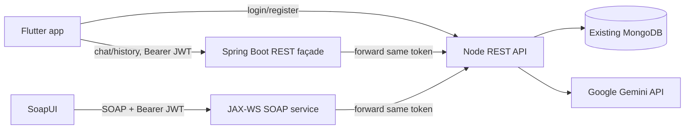

# Hkili SOA Integration

The SOA extension adds Java service interfaces around the existing Hkili
backend. It is not a replacement backend: Node.js remains the only owner of
authentication, Gemini calls, conversation rules, and MongoDB records.

## System boundaries



Spring validates the existing HS256 JWT using the same `JWT_SECRET` as Node.
It then forwards the original bearer token so Node independently verifies
signature, expiry, user, and conversation ownership. SOAP statistics also
forward the caller's bearer token. No Java service has a MongoDB or Gemini
connection.

Flutter registration and login remain on Node. Authenticated chat, listing,
history, rename, and delete use Spring; guest chat remains the existing local
flow. The Flutter base URLs are configurable using `API_BASE_URL` and
`SOA_API_BASE_URL` Dart defines.

## Modules

| Module | Responsibility |
| --- | --- |
| `soa/common-client` | Typed Java interface and HTTP client for the Node API |
| `soa/spring-rest` | Spring Boot REST façade, JWT verification and OpenAPI UI |
| `soa/jaxws-soap` | Metro SOAP endpoint; delegates real data access to Node |

The parent Maven reactor is `soa/pom.xml`. Its Maven Wrapper is the supported
build entry point.

## Prerequisites and environment

- JDK 17 for supported runtime use (the Maven compiler targets release 17).
- The wrapper downloads Maven 3.9.9 on first use; no global Maven installation
  is needed.
- A running Node backend configured with MongoDB and a matching JWT secret.
- `JWT_SECRET` exactly matching the value used by Node.
- `NODE_API_BASE_URL`, default `http://127.0.0.1:3000/api/v1`.

The current working environment did not contain JDK 17. Maven tests were
compiled with JDK 21 using `--release 17`; validate runtime behavior using an
installed JDK 17 before deployment. `soa/.env.example` contains only safe,
non-secret example values and is not automatically loaded by Java.

## Build and test

From PowerShell:

```powershell
Set-Location .\soa
.\mvnw.cmd test
```

The tests mock the Node API boundary. They do not prove a running Node,
MongoDB, Android emulator, or Gemini provider connection.

## Start Spring REST

Start Node first. In a separate PowerShell terminal:

```powershell
Set-Location .\soa\spring-rest
$env:JWT_SECRET = '<same local value as backend/.env>'
$env:NODE_API_BASE_URL = 'http://127.0.0.1:3000/api/v1'
..\mvnw.cmd spring-boot:run
```

Defaults: REST `http://localhost:8081`, OpenAPI JSON
`http://localhost:8081/v3/api-docs`, Swagger UI
`http://localhost:8081/swagger-ui.html`. Set `SPRING_PORT` to change the REST
port.

## Start SOAP

Install the Java modules to the local Maven repository once, then launch Metro:

```powershell
Set-Location .\soa
.\mvnw.cmd install -DskipTests
Set-Location .\jaxws-soap
$env:NODE_API_BASE_URL = 'http://127.0.0.1:3000/api/v1'
..\mvnw.cmd exec:java
```

The default endpoint is `http://127.0.0.1:8082/soap/hkili`; the generated WSDL
is at `http://127.0.0.1:8082/soap/hkili?wsdl`. Configure its bind address with
`SOAP_HOST` and port with `SOAP_PORT`.

### SoapUI

1. Start the SOAP service.
2. In SoapUI, create a SOAP project from
   `http://127.0.0.1:8082/soap/hkili?wsdl`.
3. Use the generated `compterMots` request without authentication.
4. For `statistiques`, add an HTTP header named `Authorization` with value
   `Bearer <existing Hkili JWT>`. Never save a real token in a committed
   project file.

Example request envelopes are in [soapui/](soapui/).

## API contracts

- [Spring REST routes, JSON shapes, and errors](rest-api.md)
- [SOAP operations, WSDL, and faults](soap.md)
- [Testing and runtime verification notes](testing.md)

## Limitations

- SOAP WSDL is generated by Metro at runtime and requires the SOAP service to
  be running.
- Conversation statistics retrieve real message pages through Node, capped at
  100 messages/page and 1,000 pages per operation.
- Local test suites mock external service calls; full-flow verification
  requires configured local services and credentials.
