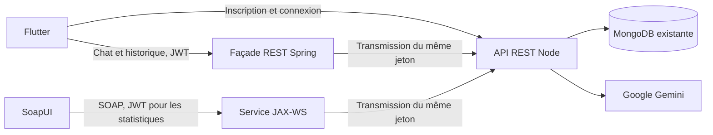

# Extension SOA de Hkili

L'extension ajoute des interfaces Java au backend existant sans le remplacer.
Node.js reste le seul propriétaire de l'authentification, des appels Gemini,
des règles de conversation et des données MongoDB.

## Architecture



Spring vérifie le jeton HS256 existant puis le transmet à Node, qui vérifie à
nouveau sa validité et la propriété des conversations. SOAP utilise le même
backend. Aucun module Java ne se connecte à MongoDB ou à Gemini.

L'inscription et la connexion Flutter restent sur Node. Le chat authentifié,
l'historique, le renommage et la suppression passent par Spring. Le mode invité
reste local. Les adresses Flutter peuvent être configurées au moyen des
variables Dart `API_BASE_URL` et `SOA_API_BASE_URL`.

## Modules

| Module | Responsabilité |
| --- | --- |
| `soa/common-client` | Client HTTP partagé pour l'API Node |
| `soa/spring-rest` | Façade Spring Boot, validation JWT et documentation OpenAPI |
| `soa/jaxws-soap` | Service SOAP Metro, données relayées à Node |

Le réacteur Maven et son wrapper se trouvent dans `soa/`.

## Prérequis et configuration

- JDK 17 pour l'exécution prise en charge ; le compilateur cible la version 17.
- Accès Internet lors du premier usage du wrapper Maven 3.9.9.
- Backend Node configuré et connecté à MongoDB.
- `JWT_SECRET` identique dans Node et Spring.
- `NODE_API_BASE_URL`, par défaut `http://127.0.0.1:3000/api/v1`.

Le JDK 17 n'était pas disponible lors de la vérification : les tests et le
packaging Maven ont été exécutés avec le JDK 25 d'IntelliJ, et les services
live avec le JRE 21 d'Eclipse. L'exécution sur JDK 17 reste à valider.
`soa/.env.example` contient uniquement des valeurs d'exemple non sensibles ;
Java ne le charge pas automatiquement.

## Tests Maven

```powershell
Set-Location .\soa
.\mvnw.cmd test
```

Les tests automatisés simulent la frontière Node. Ils n'établissent pas à eux
seuls la disponibilité de MongoDB ou de Gemini. Les résultats d'intégration
réelle sont consignés dans [testing.md](testing.md).

## Démarrage de Spring REST

Démarrez Node avant Spring. Dans un terminal PowerShell :

```powershell
Set-Location .\soa
.\mvnw.cmd -pl spring-rest -am install -DskipTests
Set-Location .\spring-rest
$secret = Read-Host 'Saisir le JWT_SECRET configuré pour Node' -AsSecureString
$env:JWT_SECRET = [System.Net.NetworkCredential]::new('', $secret).Password
Remove-Variable secret
$env:NODE_API_BASE_URL = 'http://127.0.0.1:3000/api/v1'
..\mvnw.cmd spring-boot:run
```

Par défaut, REST écoute sur `http://localhost:8081`. Le document OpenAPI est
publié à `http://localhost:8081/v3/api-docs` et Swagger UI à
`http://localhost:8081/swagger-ui.html`. `SPRING_PORT` permet de changer le
port.

## Démarrage du service SOAP

Installez les modules du réacteur, puis lancez Metro :

```powershell
Set-Location .\soa
.\mvnw.cmd install -DskipTests
Set-Location .\jaxws-soap
$env:NODE_API_BASE_URL = 'http://127.0.0.1:3000/api/v1'
..\mvnw.cmd exec:java
```

Le point d'accès par défaut est `http://127.0.0.1:8082/soap/hkili`. Le WSDL
est généré à l'exécution et accessible à
`http://127.0.0.1:8082/soap/hkili?wsdl`. `SOAP_HOST` et `SOAP_PORT` règlent
l'adresse d'écoute.

### Utilisation dans SoapUI

1. Démarrez le service SOAP.
2. Créez un projet SoapUI à partir du WSDL indiqué ci-dessus.
3. Exécutez `compterMots` sans authentification.
4. Pour `statistiques`, ajoutez dans l'en-tête HTTP `Authorization` un jeton
   émis par un compte Hkili existant. Ne sauvegardez pas le jeton dans un
   fichier versionné.

Les enveloppes de requête sont dans [soapui/](soapui/). La requête de
statistiques contient un identifiant d'exemple ; utilisez l'identifiant d'une
conversation existante pour une réponse réelle. La
[collection Postman](soapui/postman_collection.json) vérifie OpenAPI et le
rejet des routes protégées sans authentification ; elle ne contient aucun
secret ni identifiant de compte.

## Contrats

- [API REST Spring](rest-api.md)
- [Service SOAP](soap.md)
- [Tests et preuves d'intégration](testing.md)

## Limites techniques

- Le WSDL n'est disponible que lorsque Metro est démarré.
- Les statistiques parcourent les pages Node de 100 messages au plus, jusqu'à
  1 000 pages par opération.
- Le parcours Flutter manuel n'a pas été vérifié sur l'émulateur ; les tests
  automatisés Flutter et l'intégration live Java → Node sont décrits
  séparément dans [testing.md](testing.md).
